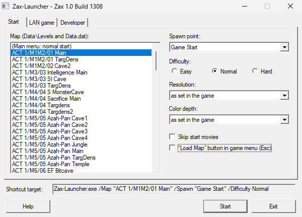
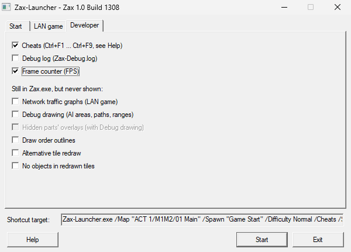
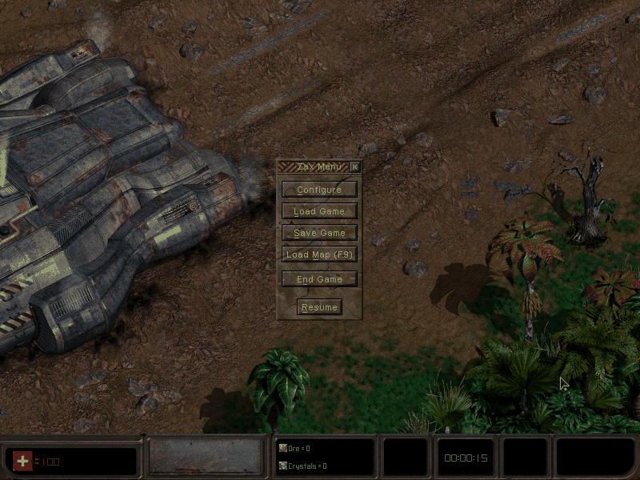

# zax-launcher

Zax-Launcher.exe, a launcher for the original Zax.exe of "Zax: The Alien Hunter" (Reflexive Entertainment / JoWooD, 2001). It starts Zax.exe from the same folder with Zax-Launcher.dll, which patches the running exe in memory; Zax.exe itself is not modified.

    Zax-Launcher.exe [/Map "Act 1/M1M2/01 Main" [/Spawn "Game Start"] [/Difficulty Normal]]
                     [/LoadMap] [/SkipMovies] [/Cheats] [/DebugLog] [/ShowFPS] [/NetGraphs] [/DebugDraw] [/ShowHidden]
                     [/DrawOutlines] [/AltDirtyDraw] [/NoEntryDraw] [/Original] [/Resolution 1024x768]
                     [-host | -connect <address>] [-name <player>]

- Start directly into a map (no main menu, no intro), at a start point and difficulty of your choice.
- A "Load Map" button in the game menu (Esc) that loads any map under `Levels` (`/LoadMap`).
- The developer switches still present in Zax.exe: debug log, frame rate, network graphs, the AIs' debug drawing, hidden parts, outlines, the developer cheats.
- Everything is off by default: without switches the game starts as without the launcher (start movies, main menu, no "Load Map" button); `/SkipMovies` is Zax.exe's own switch and is passed on like every other argument.
- Without arguments a start window opens (map, start point, difficulty, resolution, switches, LAN game); `/?` or `/help` shows the help.

| | |
|---|---|
|  |  |
| The start window (`Zax-Launcher.exe` without arguments) | Its Developer page: the developer switches still in Zax.exe |

*The game menu (Esc) with the launcher's "Load Map" button (`/LoadMap`).*

The launcher works with the original Zax.exe alone. The decompilation (zax-decomp) is a separate repository; if the decompilation's `Zax-Reimpl.dll` sits next to Zax.exe, the launcher loads it as well (`/Original` leaves out its replacement functions). How each switch works in the exe, with addresses and evidence: zax-decomp's `docs/EXE_FINDINGS.md` and `docs/DECOMPILATION.md`.

## Supported editions

The launcher reads the build of the Zax.exe next to it and shows it in the start window's title (and in `Zax-Launcher.log`):

| Zax.exe | Shown as | Support |
|---|---|---|
| Build 1308 without copy protection (German, Russian, the English no-CD exe, the exe of the demo of 2001-08-06) | Zax 1.0 Build 1308 | everything |
| Build 1309 without copy protection (Polish) | Zax 1.1 Build 1309 (Polish) | everything |
| Copy-protected with SecuROM (the German CD's build 1305, the English original 1308, the Spanish and the French 1309) | … (German CD, SecuROM), … (SecuROM), … (Spanish, SecuROM), … (French, SecuROM) | not supported: the launcher shows a message and does not start it |
| Any other (the older demos, the Chinese 1314, …) | unknown Zax.exe | the game starts, but none of the launcher's switches work |

The addresses the launcher patches are those of build 1308; in build 1309 the code from `0x59fc70` on lies 0x10 higher, everything else is the same (zax-decomp's `docs/EXE_FINDINGS.md`, "Build 1308 → 1309"). Before each patch the launcher checks the original bytes and leaves that switch off if they do not match.

## Build

macOS or Linux with [zig](https://ziglang.org) (`brew install zig`): `./build.sh [output dir]` (default `out/`) builds `Zax-Launcher.exe` and `Zax-Launcher.dll` for 32-bit Windows (XP and later), without a C runtime: they need only kernel32, user32, gdi32 and comctl32.

The icon is taken from your own Zax.exe at build time (`ZAX_EXE`, else the Zax.exe next to `ZAX_DATA`; `make_icon.py` needs `pip install -r requirements.txt`); without it the exe gets the default Windows icon. Nothing of the game is part of this repository.

## Install

Copy `Zax-Launcher.exe` and `Zax-Launcher.dll` next to `Zax.exe` of an installed game and start `Zax-Launcher.exe`.

## Licence

MIT (`LICENSE`). This licence covers only the project's own code and documentation. It grants no right to "Zax: The Alien Hunter" itself: the game, its executable, data, texts, names and artwork belong to their rights holders, are not included, and every player brings them from their own copy.
